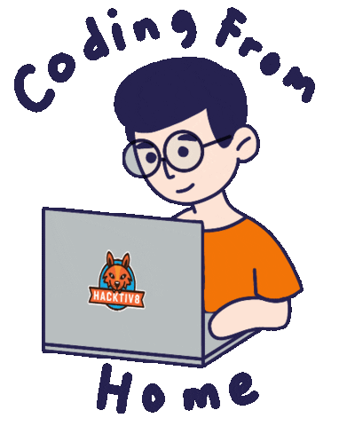
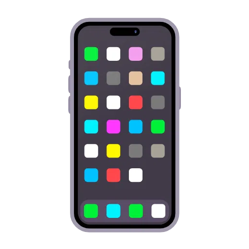
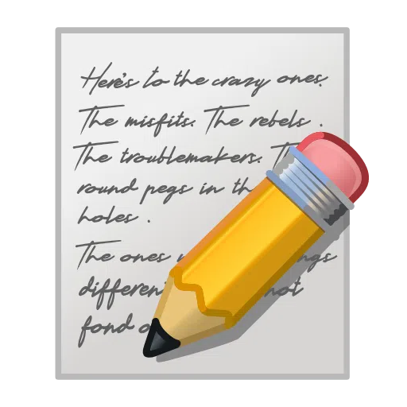

  

  <h1></h1>

  

  

    
    
    
    
  

  

---

## &nbsp;About Me

**I'm Akash 🧃** — a self-proclaimed Android developer with a strong background in technology and open source.

- **Pronouns:** he/him
- **Ask me about:** Tech, Memes, Anime
- **Creating bugs** since 2019
- **Free time:** solving problems on GeeksforGeeks and reading tech articles

---

## &nbsp;Languages &amp; Tools

  

---

## &nbsp;Featured Project

**Meoify** — a Material 3 expressive YouTube Music client with lossless audio, synced lyrics and offline playback.

  
  

---

## &nbsp;Spotify Listening

  

---

## &nbsp;Profile Summary Card

  

---

## &nbsp;Streak Stats

  

  

---

## &nbsp;Loved My Work?

  

